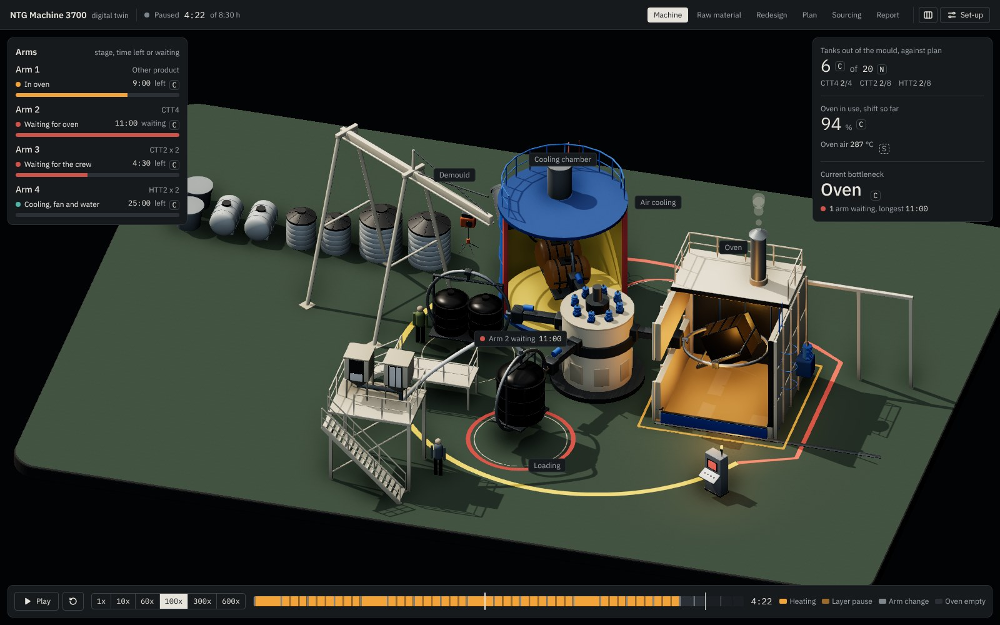

# NTG Machine 3700 digital twin

A simulated, animated model of Machine 3700, the carousel rotational-moulding machine at Nassar Techno Group (NTG), with a weekly planning tool. Built for AUB DCSN 200, Fall 2026/27.

Everything that moves on screen is driven by a discrete-event simulation. Every number has a source: **N** NTG reported, **V** team visit, **C** calculated, **S** estimate. Switch **Sources** on in the top bar to see the letters.



## Open it without installing anything

`dist-single/index.html` is the whole app in one file. Build it once (below), then double-click it. It needs no server and no internet.

## Run it from source

You need Node 22 or newer.

```bash
npm install
```

```bash
npm run dev
```

Then open the address it prints (usually http://localhost:5173).

| Command | What it does |
| --- | --- |
| `npm run dev` | Development server |
| `npm test` | Simulator, data, planning and sourcing tests |
| `npm run build` | Static site in `dist/` (needs a web server) |
| `npm run build:single` | One self-contained `dist-single/index.html` |
| `npm run concepts:sheet` | Rebuilds the concept-image contact sheet |

## What is in the app

| Screen | What it shows |
| --- | --- |
| Machine | The plant hall in 3D: the carousel with four arms, oven, cooling chamber, loading platform, hoist and tank buffer. Drag to move, scroll to zoom, click a position for its inputs. Play, pause, scrub, change speed (100x plays one 120 min arm cycle in 1.2 min). |
| Raw material | The same hall, further along: sacks, extruder, pulveriser, three silos with live levels, forklift bin to the hoppers. Drag there or use the tab. |
| Redesign | Four ways to share the arms between products over a week, side by side, with a recommendation and its rule. |
| Plan | A linear programme solved in the browser (HiGHS): tanks to make each week so stock stays above NTG's minimum with the least machine time. |
| Sourcing | Routes and landed cost for resin into Beirut, with EOQ and quantity discounts. Prices are researched estimates, not quotes. |
| Report | Validation against NTG's figures and ERP history, the assumptions register, the data inventory, and a guide for the owner. |

## Where the numbers come from

- `data/NTG_Data_Inventory_v1.xlsx`: 119 model inputs with status, source and confidence.
- `data/NTG_History_2026_Clean.xlsx`: ERP stock cards, January to November 2026.
- `tools/extract_data.py` copies both into `src/data/*.json`. `src/data/params.ts` parses each value from its inventory row, so no plant number is typed into the code.
- Inputs the inventory does not hold are in `assumed` in `src/data/params.ts`, tagged S, and listed in `docs/ASSUMPTIONS.md`.

To refresh after the workbooks change:

```bash
python3 -I tools/extract_data.py data/NTG_Data_Inventory_v1.xlsx data/NTG_History_2026_Clean.xlsx src/data
```

## How the simulator works, in short

Four independent arms travel one way round five positions (loading, oven, air cooling, cooling chamber, demould) and cannot overtake. A position holds one arm, so the oven serves one arm at a time. For layers 2 and 3 the arm swings back out to loading, is dosed, and returns; those swings are part of the 28.5 min oven visit. The arm cycle is an output of the model, not an input. With the inventory's times it comes out at 120 min and 4 + 8 + 8 tanks from a shift, which is what NTG reports. See `docs/MODEL.md`.

**Calibrated, not validated.** No timed shift log exists yet. Known gaps are stated in the Report screen rather than tuned away. The main one: the last two arms come out 8.5 and 38.5 minutes after the 8.5 h mark.

## Layout

```
src/sim/       simulator (pure TypeScript, no React): engine, stateAt, scenarios, tests
src/data/      inventory and history as JSON, typed loader with provenance
src/scene/     3D scene: stage (camera, lights), machine parts, raw-material hall
src/ui/        dashboard panels, set-up drawer, shared interface pieces
src/pages/     Plan, Sourcing, Redesign, Report
src/design/    design tokens from docs/STYLE_BIBLE.md
docs/          style bible, model note, assumptions, build log, screenshots
tools/         data extraction, screenshots, concept contact sheet
```

## Disclosure

This tool was built with AI assistance (Claude). The team is responsible for checking that it is correct. NTG's data is used with the understanding set out in the course brief: do not share it further without NTG's agreement.
